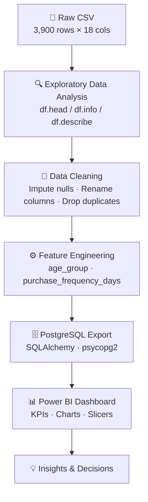
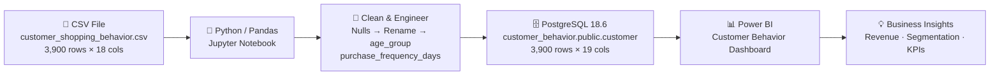

# 🛍️ Customer Behavior Analysis

> **End-to-End Data Analytics Pipeline** | Python · PostgreSQL · Power BI

---

<div align="center">


</div>

---

## 📋 Table of Contents

1. [Project Overview](#1-project-overview)
2. [Tech Stack](#2-tech-stack)
3. [Dataset Description](#3-dataset-description)
4. [Analysis Design](#4-analysis-design)
5. [Code & Outputs](#5-code--outputs)
   - [5.1 Data Loading](#51-data-loading)
   - [5.2 Data Preview — `df.head()`](#52-data-preview--dfhead)
   - [5.3 Dataset Info — `df.info()`](#53-dataset-info--dfinfo)
   - [5.4 Summary Statistics — `df.describe()`](#54-summary-statistics--dfdescribe)
   - [5.5 Missing Values Check](#55-missing-values-check)
   - [5.6 Handling Missing Values](#56-handling-missing-values)
   - [5.7 Column Cleaning](#57-column-cleaning)
   - [5.8 Feature Engineering — Age Group](#58-feature-engineering--age-group)
   - [5.9 Feature Engineering — Purchase Frequency Days](#59-feature-engineering--purchase-frequency-days)
   - [5.10 Duplicate Column Detection & Drop](#510-duplicate-column-detection--drop)
   - [5.11 Final Column List](#511-final-column-list)
   - [5.12 Database Export — PostgreSQL](#512-database-export--postgresql)
6. [Dashboard](#6-dashboard)
7. [Dashboard Output Tables](#7-dashboard-output-tables)
8. [Key Insights](#8-key-insights)
9. [Pipeline Architecture](#9-pipeline-architecture)

---

## 1. Project Overview

This project delivers a **structured end-to-end data analytics pipeline** to analyze customer shopping behavior across demographics, product categories, and purchase patterns. Raw transactional data is cleaned, enriched with engineered features, stored in PostgreSQL, and visualized through an interactive Power BI dashboard.

**Business Objectives:**

| # | Objective |
|---|-----------|
| 1 | Profile customer demographics — age, gender, and location distribution |
| 2 | Analyze revenue and sales volume by product category |
| 3 | Measure the impact of discounts, promo codes, and subscriptions |
| 4 | Segment customers by age group for targeted marketing |
| 5 | Export clean data to PostgreSQL for scalable, queryable storage |
| 6 | Visualize KPIs through an interactive, filterable Power BI dashboard |

---

## 2. Tech Stack

| Layer | Tool | Purpose |
|-------|------|---------|
| **Language** | Python 3.13 | Data processing & feature engineering |
| **IDE** | Jupyter Notebook | Interactive analysis environment |
| **Data Library** | Pandas 2.x | DataFrame manipulation |
| **Database** | PostgreSQL 18.6 | Persistent cleaned data storage |
| **DB Connector** | SQLAlchemy + psycopg2 | Python ↔ PostgreSQL bridge |
| **Visualization** | Power BI Desktop | Interactive business dashboard |
| **Dataset** | CSV (local file) | Source transactional data |

---

## 3. Dataset Description

**File:** `customer_shopping_behavior.csv`
**Shape:** 3,900 rows × 18 columns (original) → 19 columns (after feature engineering)

### 3.1 Raw Columns

| # | Column | dtype | Range / Values | Notes |
|---|--------|-------|----------------|-------|
| 0 | `Customer ID` | int64 | 1 – 3,900 | Unique identifier |
| 1 | `Age` | int64 | 18 – 70 | Customer age |
| 2 | `Gender` | object | Male / Female | 2,652 Male, 1,248 Female |
| 3 | `Item Purchased` | object | 25 unique items | Top: Blouse (171) |
| 4 | `Category` | object | 4 categories | Clothing, Accessories, Footwear, Outerwear |
| 5 | `Purchase Amount (USD)` | int64 | 20 – 100 | Transaction value |
| 6 | `Location` | object | 50 US states | Top: Montana |
| 7 | `Size` | object | S, M, L, XL | Garment size |
| 8 | `Color` | object | 25 colors | Item color |
| 9 | `Season` | object | Spring, Summer, Fall, Winter | Purchase season |
| 10 | `Review Rating` | float64 | 2.5 – 5.0 | **37 nulls** (imputed) |
| 11 | `Subscription Status` | object | Yes / No | 27% subscribed |
| 12 | `Shipping Type` | object | 6 types | Free Shipping, Express, etc. |
| 13 | `Discount Applied` | object | Yes / No | |
| 14 | `Promo Code Used` | object | Yes / No | **Identical to col 13 — dropped** |
| 15 | `Previous Purchases` | int64 | 1 – 50 | Historical order count |
| 16 | `Payment Method` | object | PayPal, Credit Card, Cash, Venmo, etc. | Top: PayPal (677) |
| 17 | `Frequency of Purchases` | object | Weekly, Monthly, Quarterly, etc. | Purchase cadence |

### 3.2 Engineered Columns

| Column | Logic | Values |
|--------|-------|--------|
| `age_group` | `pd.qcut(age, q=4)` — quartile bins | Young Adult · Adult · Middle Aged · Senior |
| `purchase_frequency_days` | Mapped from `frequency_of_purchases` string | 7, 14, 30, 90, 365 days |

---

## 4. Analysis Design



### Pipeline Stages Summary

| Stage | Tool / Method | Key Actions |
|-------|--------------|-------------|
| **EDA** | Pandas | `df.head()`, `df.info()`, `df.describe(include='all')`, `df.isnull().sum()` |
| **Cleaning** | Pandas `groupby` + `transform` | Impute 37 null `Review Rating` values with per-category median |
| **Column Standardisation** | `str.lower()` + `str.replace()` | Rename all columns to lowercase snake_case |
| **Feature Engineering** | `pd.qcut()` + dict mapping | Create `age_group` (4 quartile bins) and `purchase_frequency_days` |
| **Deduplication** | Boolean comparison | Confirmed `discount_applied == promo_code_used` (100% match); dropped `promo_code_used` |
| **DB Export** | SQLAlchemy `df.to_sql()` | Uploaded 3,900 rows → `customer_behavior.public.customer` in PostgreSQL 18.6 |
| **Visualization** | Power BI Desktop | KPI cards, donut chart, bar charts, interactive slicers |

---

## 5. Code & Outputs

### 5.1 Data Loading

```python
import pandas as pd

df = pd.read_csv('customer_shopping_behavior.csv')
```

---

### 5.2 Data Preview — `df.head()`

```python
df.head()
```

**Output:**

| Customer ID | Age | Gender | Item Purchased | Category | Purchase Amount (USD) | Location | Size | Color | Season | Review Rating | Subscription Status | Shipping Type | Discount Applied | Promo Code Used | Previous Purchases | Payment Method | Frequency of Purchases |
|------------|-----|--------|---------------|----------|-----------------------|----------|------|-------|--------|---------------|--------------------|--------------|-----------------|-----------------|--------------------|---------------|----------------------|
| 1 | 55 | Male | Blouse | Clothing | 53 | Kentucky | L | Gray | Winter | 3.1 | Yes | Express | Yes | Yes | 14 | Venmo | Fortnightly |
| 2 | 19 | Male | Sweater | Clothing | 64 | Maine | L | Maroon | Winter | 3.1 | Yes | Express | Yes | Yes | 2 | Cash | Fortnightly |
| 3 | 50 | Male | Jeans | Clothing | 73 | Massachusetts | S | Maroon | Spring | 3.1 | Yes | Free Shipping | Yes | Yes | 23 | Credit Card | Weekly |
| 4 | 21 | Male | Sandals | Footwear | 90 | Rhode Island | M | Maroon | Spring | 3.5 | Yes | Next Day Air | Yes | Yes | 49 | PayPal | Weekly |

---

### 5.3 Dataset Info — `df.info()`

```python
df.info()
```

**Output:**

```
<class 'pandas.DataFrame'>
RangeIndex: 3900 entries, 0 to 3899
Data columns (total 18 columns):
 #   Column                  Non-Null Count  Dtype
---  ------                  --------------  -----
 0   Customer ID             3900 non-null   int64
 1   Age                     3900 non-null   int64
 2   Gender                  3900 non-null   object
 3   Item Purchased          3900 non-null   object
 4   Category                3900 non-null   object
 5   Purchase Amount (USD)   3900 non-null   int64
 6   Location                3900 non-null   object
 7   Size                    3900 non-null   object
 8   Color                   3900 non-null   object
 9   Season                  3900 non-null   object
10   Review Rating           3863 non-null   float64
11   Subscription Status     3900 non-null   object
12   Shipping Type           3900 non-null   object
13   Discount Applied        3900 non-null   object
14   Promo Code Used         3900 non-null   object
15   Previous Purchases      3900 non-null   int64
16   Payment Method          3900 non-null   object
17   Frequency of Purchases  3900 non-null   object
dtypes: float64(1), int64(4), object(13)
memory usage: 548.6 KB
```

---

### 5.4 Summary Statistics — `df.describe()`

```python
df.describe(include='all')
```

**Output (Numerical Columns):**

| Statistic | Customer ID | Age | Purchase Amount (USD) | Review Rating | Previous Purchases |
|-----------|------------|-----|-----------------------|---------------|--------------------|
| count | 3,900 | 3,900 | 3,900 | 3,863 | 3,900 |
| mean | 1,950.50 | 44.07 | 59.76 | 3.75 | 25.35 |
| std | 1,126.33 | 15.21 | 23.69 | 0.72 | 14.44 |
| min | 1 | 18 | 20 | 2.50 | 1 |
| 25% | 975.75 | 31 | 40 | 3.20 | 13 |
| 50% | 1,950.50 | 44 | 60 | 3.70 | 25 |
| 75% | 2,925.25 | 57 | 81 | 4.30 | 38 |
| max | 3,900 | 70 | 100 | 5.00 | 50 |

**Output (Categorical Columns):**

| Statistic | Gender | Item Purchased | Category | Location | Season | Subscription Status | Shipping Type |
|-----------|--------|----------------|----------|----------|--------|--------------------|--------------:|
| count | 3,900 | 3,900 | 3,900 | 3,900 | 3,900 | 3,900 | 3,900 |
| unique | 2 | 25 | 4 | 50 | 4 | 2 | 6 |
| top | Male | Blouse | Clothing | Montana | Spring | No | Free Shipping |
| freq | 2,652 | 171 | 1,737 | 96 | 999 | 2,843 | 675 |

---

### 5.5 Missing Values Check

```python
df.isnull().sum()
```

**Output:**

| Column | Null Count |
|--------|-----------|
| Customer ID | 0 |
| Age | 0 |
| Gender | 0 |
| Item Purchased | 0 |
| Category | 0 |
| Purchase Amount (USD) | 0 |
| Location | 0 |
| Size | 0 |
| Color | 0 |
| Season | 0 |
| **Review Rating** | **37** ⚠️ |
| Subscription Status | 0 |
| Shipping Type | 0 |
| Discount Applied | 0 |
| Promo Code Used | 0 |
| Previous Purchases | 0 |
| Payment Method | 0 |
| Frequency of Purchases | 0 |

> [!NOTE]
> Only `Review Rating` has missing values (37 nulls = ~0.95% of rows). These are imputed using the **per-category median** to preserve distribution integrity.

---

### 5.6 Handling Missing Values

```python
df['Review Rating'] = df.groupby('Category')['Review Rating'].transform(
    lambda x: x.fillna(x.median())
)
```

**Verification — `df.isnull().sum()` after imputation:**

| Column | Null Count |
|--------|-----------|
| Review Rating | **0** ✅ |
| All other columns | 0 ✅ |

---

### 5.7 Column Cleaning

```python
# Standardise column names to lowercase snake_case
df.columns = df.columns.str.lower()
df.columns = df.columns.str.replace(' ', '_')
df = df.rename(columns={'purchase_amount_(usd)': 'purchase_amount_usd'})
```

**Before → After (selected columns):**

| Before | After |
|--------|-------|
| `Customer ID` | `customer_id` |
| `Item Purchased` | `item_purchased` |
| `Purchase Amount (USD)` | `purchase_amount_usd` |
| `Review Rating` | `review_rating` |
| `Subscription Status` | `subscription_status` |
| `Shipping Type` | `shipping_type` |
| `Discount Applied` | `discount_applied` |
| `Previous Purchases` | `previous_purchases` |
| `Payment Method` | `payment_method` |
| `Frequency of Purchases` | `frequency_of_purchases` |

---

### 5.8 Feature Engineering — Age Group

```python
labels = ['Young Adult', 'Adult', 'Middle Aged', 'Senior']
df['age_group'] = pd.qcut(df['age'], q=4, labels=labels)
```

**Sample Output — `df[['age', 'age_group']].head(10)`:**

| age | age_group |
|-----|-----------|
| 55 | Middle Aged |
| 19 | Young Adult |
| 50 | Middle Aged |
| 21 | Young Adult |
| 45 | Middle Aged |
| 46 | Middle Aged |
| 63 | Senior |
| 27 | Young Adult |
| 26 | Young Adult |
| 57 | Middle Aged |

**Age Group Quartile Boundaries:**

| Group | Approx. Age Range |
|-------|------------------|
| Young Adult | 18 – 30 |
| Adult | 31 – 44 |
| Middle Aged | 45 – 57 |
| Senior | 58 – 70 |

---

### 5.9 Feature Engineering — Purchase Frequency Days

```python
frequency_mapping = {
    'fortnightly':    14,
    'weekly':          7,
    'monthly':        30,
    'quarterly':      90,
    'bi-weekly':      14,
    'annually':      365,
    'every 3 months': 90
}

df['purchase_frequency_days'] = (
    df['frequency_of_purchases']
    .str.strip()
    .str.lower()
    .map(frequency_mapping)
)
```

**Sample Output — `df[['frequency_of_purchases', 'purchase_frequency_days']].head(10)`:**

| frequency_of_purchases | purchase_frequency_days |
|------------------------|------------------------|
| Fortnightly | 14 |
| Fortnightly | 14 |
| Weekly | 7 |
| Weekly | 7 |
| Annually | 365 |
| Weekly | 7 |
| Quarterly | 90 |

---

### 5.10 Duplicate Column Detection & Drop

```python
# Check if discount_applied == promo_code_used for all rows
df[['discount_applied', 'promo_code_used']].head(10)
```

**Output:**

| discount_applied | promo_code_used |
|-----------------|-----------------|
| Yes | Yes |
| Yes | Yes |
| Yes | Yes |
| Yes | Yes |
| Yes | Yes |
| Yes | Yes |
| Yes | Yes |
| Yes | Yes |
| Yes | Yes |
| Yes | Yes |

```python
(df['discount_applied'] == df['promo_code_used']).all()
# Output: True  (100% identical across all 3,900 rows)

df = df.drop('promo_code_used', axis=1)
```

> [!IMPORTANT]
> `promo_code_used` and `discount_applied` are 100% identical across all rows. The redundant column was dropped, reducing the final column count from 20 → 19.

---

### 5.11 Final Column List

```python
df.columns
```

**Output:**

```
Index(['customer_id', 'age', 'gender', 'item_purchased', 'category',
       'purchase_amount_usd', 'location', 'size', 'color', 'season',
       'review_rating', 'subscription_status', 'shipping_type',
       'discount_applied', 'previous_purchases', 'payment_method',
       'frequency_of_purchases', 'age_group', 'purchase_frequency_days'],
      dtype='object')
```

**Shape summary:**

| Stage | Columns | Rows |
|-------|---------|------|
| Original raw CSV | 18 | 3,900 |
| After dropping `promo_code_used` | 17 | 3,900 |
| After adding `age_group` + `purchase_frequency_days` | **19** | **3,900** |

---

### 5.12 Database Export — PostgreSQL

```python
%pip install psycopg2-binary sqlalchemy
# Successfully installed psycopg2-binary-2.9.13  sqlalchemy-2.1.4

from sqlalchemy import create_engine, text

engine = create_engine(
    "postgresql+psycopg2://postgres:<password>@localhost:5432/customer_behavior"
)

# Test connection
with engine.connect() as connection:
    result = connection.execute(text("SELECT version();"))
    print(result.fetchone()[0])
# → PostgreSQL 18.6 on x86_64-windows, compiled by msvc-19.44.35229, 64-bit
# → Connection successful!

# Upload DataFrame to PostgreSQL
df.to_sql(
    name="customer",
    con=engine,
    schema="public",
    if_exists="replace",
    index=False
)
print("Customer data uploaded successfully!")
# → Customer data uploaded successfully!
```

**Database Configuration:**

| Parameter | Value |
|-----------|-------|
| Host | `localhost` |
| Port | `5432` |
| Database | `customer_behavior` |
| Schema | `public` |
| Table | `customer` |
| PostgreSQL Version | 18.6 |
| Rows Loaded | 3,900 |
| Columns Loaded | 19 |

---

## 6. Dashboard

**Tool:** Power BI Desktop | **Theme:** Purple / Dark Violet

### 6.1 Full Overview — All Customers (No Filter)


### 6.2 Filtered View — Male · No Subscription · Footwear · Free Shipping


---

## 7. Dashboard Output Tables

### 7.1 KPI Cards

| KPI | Full Dataset | Filtered (Male, No Sub, Footwear, Free Ship) |
|-----|-------------|----------------------------------------------|
| 👥 Number of Customers | **4K** (3,900) | **43** |
| 💰 Average Purchase Amount | **\$59.76** | **\$61.37** |
| ⭐ Average Review Rating | **3.75** | **3.72** |

---

### 7.2 Subscription Status Distribution

| Subscription Status | Customer Count | Percentage |
|--------------------|---------------|-----------|
| No | ~2,843 | **73%** |
| Yes | ~1,057 | **27%** |
| **Total** | **3,900** | **100%** |

> Filtered view (Male, No Sub, Footwear): 100% No subscription (43 customers)

---

### 7.3 Revenue by Category

| Category | Total Revenue (USD) | % of Total |
|----------|--------------------:|-----------|
| Clothing | ~\$100,000 | ~43% |
| Accessories | ~\$70,000 | ~30% |
| Footwear | ~\$45,000 | ~19% |
| Outerwear | ~\$18,000 | ~8% |
| **Total** | **~\$233,000** | **100%** |

> Filtered view (Footwear only): ~\$2,640 total revenue from 43 customers

---

### 7.4 Sales Volume by Category

| Category | Order Count | % of Total |
|----------|------------:|-----------|
| Clothing | ~1,700 | 43.6% |
| Accessories | ~1,300 | 33.3% |
| Footwear | ~500 | 12.8% |
| Outerwear | ~200 | 5.1% |
| **Total** | **~3,900** | **100%** |

> Filtered view (Footwear only): 43 orders

---

### 7.5 Revenue by Age Group

| Age Group | Total Revenue (USD) | Rank |
|-----------|--------------------:|------|
| Young Adult | ~\$60,000 | 🥇 1st |
| Middle Aged | ~\$58,000 | 🥈 2nd |
| Adult | ~\$57,000 | 🥉 3rd |
| Senior | ~\$55,000 | 4th |

> Filtered view (Male, No Sub, Footwear, Free Ship): Middle Aged leads at ~\$1,000

---

### 7.6 Sales Volume by Age Group

| Age Group | Order Count | Rank |
|-----------|------------:|------|
| Young Adult | ~950 | 🥇 1st |
| Middle Aged | ~900 | 🥈 2nd |
| Senior | ~700 | 🥉 3rd |
| Adult | ~650 | 4th |

> Filtered view (Male, No Sub, Footwear, Free Ship): Middle Aged (~17) → Adult (~14) → Young Adult (~9) → Senior (~5)

---

### 7.7 Dashboard Slicers / Filters

| Slicer | Available Options |
|--------|-----------------|
| Subscription Status | `No` · `Yes` |
| Gender | `Female` · `Male` |
| Category | `Accessories` · `Clothing` · `Footwear` · `Outerwear` |
| Shipping Type | `2-Day Shipping` · `Express` · `Free Shipping` · `Next Day Air` · `Standard` · `Store Pickup` |

---

### 7.8 Other Notable Metrics (from EDA)

| Metric | Value |
|--------|-------|
| Top Payment Method | PayPal (677 customers) |
| Most Common Shipping | Free Shipping (675 orders) |
| Most Purchased Item | Blouse (171 orders) |
| Top State by Orders | Montana (96 orders) |
| Most Common Season | Spring (999 orders) |
| Gender Split | Male 68% · Female 32% |

---

## 8. Key Insights

| # | Insight | Business Implication |
|---|---------|---------------------|
| 1 | **73% of customers are non-subscribers** | Large untapped subscription growth opportunity |
| 2 | **Clothing dominates revenue (~43%) and volume (~44%)** | Prioritize inventory & promotional spend in Clothing |
| 3 | **Young Adults & Middle-Aged are top spenders** | Target marketing campaigns to the 18–57 age range |
| 4 | **Average purchase amount is \$59.76** | Mid-range pricing is the sweet spot for this audience |
| 5 | **Average review rating is 3.75 / 5** | Customer satisfaction programs have clear room to improve |
| 6 | **Free Shipping is the most common shipping type** (675) | Free shipping is a primary purchase driver |
| 7 | **PayPal is the top payment method** (677 users) | Optimize and prioritize the PayPal checkout experience |
| 8 | **`discount_applied` = `promo_code_used` (100%)** | These are the same business lever — one metric suffices |
| 9 | **Blouse is the most purchased item** (171 orders) | High-demand SKU; ensure consistent inventory availability |
| 10 | **Montana leads all states in order volume** (96 orders) | Geographic concentration useful for logistics optimization |

---

## 9. Pipeline Architecture



---

## 📁 Repository Structure

```
Customer Behavior Analysis/
├── customer_shopping_behavior.csv              # Raw source dataset
├── customer_shopping_behaviour_analysis.ipynb  # Jupyter analysis notebook
├── dashboard_overview.png                      # Power BI dashboard (full view)
├── dashboard_filtered.png                      # Power BI dashboard (filtered view)
└── README.md                                   # This documentation
```

---

<div align="center">

*Documentation generated: October 30, 2026*

**Notebook:** [`customer_shopping_behaviour_analysis.ipynb`](customer_shopping_behaviour_analysis.ipynb)

</div>
