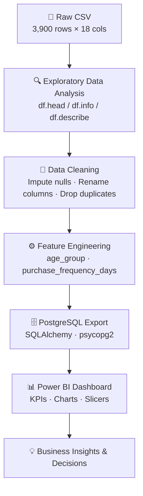
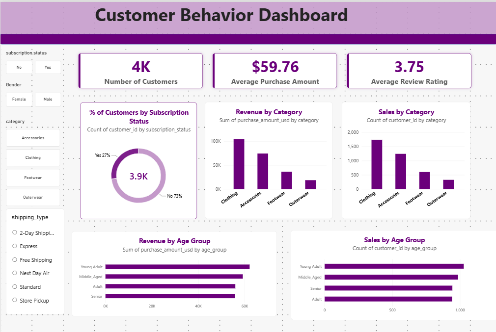
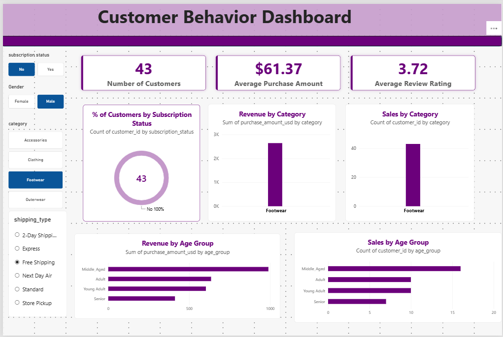
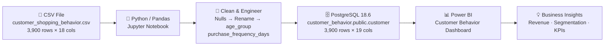

<div align="center">

# CustomerPulse Analytics
### Customer Behavior Analysis — End-to-End Data Analytics Pipeline

<br/>

[](https://www.python.org/)
[](https://pandas.pydata.org/)
[](https://www.postgresql.org/)
[](https://powerbi.microsoft.com/)
[](https://jupyter.org/)

<br/>

> **An end-to-end analytics project** that transforms raw retail transaction data into actionable business insights — through Python-based data cleaning, PostgreSQL storage, and an interactive Power BI dashboard.

<br/>

| Metric | Value |
|--------|-------|
| 👥 Customers Analysed | **3,900** |
| 💰 Avg. Purchase Amount | **\$59.76** |
| ⭐ Avg. Review Rating | **3.75 / 5** |
| 🗄️ Database | **PostgreSQL 18.6** |
| 📊 Dashboard Tool | **Power BI** |

</div>

---

## 📋 Table of Contents

1. [Project Overview](#1-project-overview)
2. [Project Highlights](#2-project-highlights)
3. [Technology Stack](#3-technology-stack)
4. [Dataset Description](#4-dataset-description)
5. [Project Workflow](#5-project-workflow)
6. [Data Cleaning & Preprocessing](#6-data-cleaning--preprocessing)
   - [6.1 Data Loading](#61-data-loading)
   - [6.2 Data Preview — `df.head()`](#62-data-preview--dfhead)
   - [6.3 Dataset Info — `df.info()`](#63-dataset-info--dfinfo)
   - [6.4 Summary Statistics — `df.describe()`](#64-summary-statistics--dfdescribe)
   - [6.5 Missing Values Check](#65-missing-values-check)
   - [6.6 Handling Missing Values](#66-handling-missing-values)
   - [6.7 Column Standardisation](#67-column-standardisation)
7. [Feature Engineering](#7-feature-engineering)
   - [7.1 Age Group Segmentation](#71-age-group-segmentation)
   - [7.2 Purchase Frequency Days](#72-purchase-frequency-days)
   - [7.3 Duplicate Column Detection & Drop](#73-duplicate-column-detection--drop)
   - [7.4 Final Column List](#74-final-column-list)
8. [PostgreSQL Database Integration](#8-postgresql-database-integration)
9. [Power BI Dashboard](#9-power-bi-dashboard)
   - [9.1 Dashboard Screenshots](#91-dashboard-screenshots)
   - [9.2 KPI Cards](#92-kpi-cards)
   - [9.3 Revenue & Sales by Category](#93-revenue--sales-by-category)
   - [9.4 Revenue & Sales by Age Group](#94-revenue--sales-by-age-group)
   - [9.5 Subscription Distribution](#95-subscription-distribution)
   - [9.6 Interactive Slicers](#96-interactive-slicers)
   - [9.7 Other Notable EDA Metrics](#97-other-notable-eda-metrics)
10. [Key Business Insights](#10-key-business-insights)
11. [Pipeline Architecture](#11-pipeline-architecture)
12. [Project Structure](#12-project-structure)
13. [Installation & Setup](#13-installation--setup)
14. [How to Run the Project](#14-how-to-run-the-project)
15. [Conclusion](#15-conclusion)
16. [Future Improvements](#16-future-improvements)

---

## 1. Project Overview

**CustomerPulse Analytics** is a structured, end-to-end data analytics project built to understand customer shopping behaviour across demographics, product categories, and purchase frequencies. It processes raw retail transaction data through a full analytics pipeline — cleaning, feature engineering, database export, and dashboard visualisation — to surface actionable business intelligence.

The dataset contains **3,900 customer transaction records** from a US retail environment spanning clothing, accessories, footwear, and outerwear categories.

**Business Problem:**
Retail businesses often have rich transaction data but lack visibility into *who* their customers are, *what* they buy, *how often* they shop, and *which channels and categories* drive the most revenue. This project addresses those questions through a reproducible, well-documented analytics workflow.

---

## 2. Project Highlights

- ✅ **Full pipeline from raw CSV to interactive Power BI dashboard**
- ✅ **3,900 customer records** cleaned, engineered, and stored in PostgreSQL
- ✅ **2 engineered features** — `age_group` (quartile segmentation) and `purchase_frequency_days` (numeric mapping)
- ✅ **Null imputation** using per-category median (37 missing `Review Rating` values)
- ✅ **Redundant column detection** — `promo_code_used` confirmed 100% identical to `discount_applied` and dropped
- ✅ **PostgreSQL 18.6 integration** via SQLAlchemy + psycopg2
- ✅ **Interactive Power BI dashboard** with 4 slicers, 3 KPI cards, and 5 charts
- ✅ **10 key business insights** with actionable implications

---

## 3. Technology Stack

| Layer | Tool / Library | Version | Purpose |
|-------|---------------|---------|---------|
| Language | Python | 3.13 | Core data processing and scripting |
| Environment | Jupyter Notebook | — | Interactive, reproducible analysis |
| Data Processing | Pandas | 2.x | DataFrame manipulation and transformation |
| Database | PostgreSQL | 18.6 | Persistent, queryable cleaned data storage |
| DB Connector | SQLAlchemy + psycopg2 | 2.1.4 / 2.9.13 | Python ↔ PostgreSQL bridge |
| Visualisation | Power BI Desktop | — | Interactive KPI dashboard |
| Data Source | CSV (local file) | — | Raw transactional source data |

---

## 4. Dataset Description

**File:** `customer_shopping_behavior.csv`
**Shape:** 3,900 rows × 18 columns (original) → 19 columns (after feature engineering)

### 4.1 Raw Columns

| # | Column | dtype | Range / Unique Values | Notes |
|---|--------|-------|-----------------------|-------|
| 0 | `Customer ID` | int64 | 1 – 3,900 | Unique customer identifier |
| 1 | `Age` | int64 | 18 – 70 | Customer age |
| 2 | `Gender` | object | Male / Female | 2,652 Male · 1,248 Female |
| 3 | `Item Purchased` | object | 25 unique items | Most frequent: Blouse (171) |
| 4 | `Category` | object | 4 categories | Clothing · Accessories · Footwear · Outerwear |
| 5 | `Purchase Amount (USD)` | int64 | \$20 – \$100 | Transaction value |
| 6 | `Location` | object | 50 US states | Top state: Montana (96 orders) |
| 7 | `Size` | object | S, M, L, XL | Garment size |
| 8 | `Color` | object | 25 unique colors | Item color |
| 9 | `Season` | object | Spring · Summer · Fall · Winter | Season of purchase |
| 10 | `Review Rating` | float64 | 2.5 – 5.0 | ⚠️ **37 null values** — imputed |
| 11 | `Subscription Status` | object | Yes / No | 27% subscribed |
| 12 | `Shipping Type` | object | 6 types | Free Shipping, Express, etc. |
| 13 | `Discount Applied` | object | Yes / No | — |
| 14 | `Promo Code Used` | object | Yes / No | ⚠️ **100% identical to col 13 — dropped** |
| 15 | `Previous Purchases` | int64 | 1 – 50 | Historical order count |
| 16 | `Payment Method` | object | PayPal, Credit Card, Cash, Venmo, etc. | Top: PayPal (677) |
| 17 | `Frequency of Purchases` | object | Weekly, Monthly, Quarterly, etc. | Purchase cadence string |

### 4.2 Engineered Columns (Added During Processing)

| Column | Method | Possible Values |
|--------|--------|-----------------|
| `age_group` | `pd.qcut(age, q=4)` — quartile binning | Young Adult · Adult · Middle Aged · Senior |
| `purchase_frequency_days` | Dictionary mapping from `frequency_of_purchases` | 7, 14, 30, 90, 365 (integer, days) |

---

## 5. Project Workflow



| Stage | Tool / Method | Key Actions |
|-------|--------------|-------------|
| **EDA** | Pandas | `df.head()`, `df.info()`, `df.describe(include='all')`, `df.isnull().sum()` |
| **Null Imputation** | `groupby` + `transform` | Fill 37 missing `Review Rating` values with per-category median |
| **Column Standardisation** | `str.lower()` + `str.replace()` | Rename all columns to lowercase snake_case |
| **Feature Engineering** | `pd.qcut()` + dict mapping | Create `age_group` and `purchase_frequency_days` |
| **Deduplication** | Boolean equality check | Confirmed `discount_applied == promo_code_used` (100%); dropped the latter |
| **Database Export** | SQLAlchemy `df.to_sql()` | Upload 3,900 rows → `customer_behavior.public.customer` |
| **Visualisation** | Power BI Desktop | KPI cards, donut chart, bar charts, interactive slicers |

---

## 6. Data Cleaning & Preprocessing

### 6.1 Data Loading

```python
import pandas as pd

df = pd.read_csv('customer_shopping_behavior.csv')
```

---

### 6.2 Data Preview — `df.head()`

```python
df.head()
```

**Output:**

| Customer ID | Age | Gender | Item Purchased | Category | Purchase Amount (USD) | Location | Size | Color | Season | Review Rating | Subscription Status | Shipping Type | Discount Applied | Promo Code Used | Previous Purchases | Payment Method | Frequency of Purchases |
|------------|-----|--------|---------------|----------|-----------------------|----------|------|-------|--------|---------------|--------------------|--------------|-----------------|-----------------|--------------------|---------------|----------------------|
| 1 | 55 | Male | Blouse | Clothing | 53 | Kentucky | L | Gray | Winter | 3.1 | Yes | Express | Yes | Yes | 14 | Venmo | Fortnightly |
| 2 | 19 | Male | Sweater | Clothing | 64 | Maine | L | Maroon | Winter | 3.1 | Yes | Express | Yes | Yes | 2 | Cash | Fortnightly |
| 3 | 50 | Male | Jeans | Clothing | 73 | Massachusetts | S | Maroon | Spring | 3.1 | Yes | Free Shipping | Yes | Yes | 23 | Credit Card | Weekly |
| 4 | 21 | Male | Sandals | Footwear | 90 | Rhode Island | M | Maroon | Spring | 3.5 | Yes | Next Day Air | Yes | Yes | 49 | PayPal | Weekly |

---

### 6.3 Dataset Info — `df.info()`

```python
df.info()
```

**Output:**

```
<class 'pandas.DataFrame'>
RangeIndex: 3900 entries, 0 to 3899
Data columns (total 18 columns):
 #   Column                  Non-Null Count  Dtype
---  ------                  --------------  -----
 0   Customer ID             3900 non-null   int64
 1   Age                     3900 non-null   int64
 2   Gender                  3900 non-null   object
 3   Item Purchased          3900 non-null   object
 4   Category                3900 non-null   object
 5   Purchase Amount (USD)   3900 non-null   int64
 6   Location                3900 non-null   object
 7   Size                    3900 non-null   object
 8   Color                   3900 non-null   object
 9   Season                  3900 non-null   object
10   Review Rating           3863 non-null   float64
11   Subscription Status     3900 non-null   object
12   Shipping Type           3900 non-null   object
13   Discount Applied        3900 non-null   object
14   Promo Code Used         3900 non-null   object
15   Previous Purchases      3900 non-null   int64
16   Payment Method          3900 non-null   object
17   Frequency of Purchases  3900 non-null   object
dtypes: float64(1), int64(4), object(13)
memory usage: 548.6 KB
```

---

### 6.4 Summary Statistics — `df.describe()`

```python
df.describe(include='all')
```

**Numerical Columns:**

| Statistic | Customer ID | Age | Purchase Amount (USD) | Review Rating | Previous Purchases |
|-----------|------------|-----|----------------------|---------------|-------------------|
| count | 3,900 | 3,900 | 3,900 | 3,863 | 3,900 |
| mean | 1,950.50 | 44.07 | **59.76** | **3.75** | 25.35 |
| std | 1,126.33 | 15.21 | 23.69 | 0.72 | 14.44 |
| min | 1 | 18 | 20 | 2.50 | 1 |
| 25% | 975.75 | 31 | 40 | 3.20 | 13 |
| 50% | 1,950.50 | 44 | 60 | 3.70 | 25 |
| 75% | 2,925.25 | 57 | 81 | 4.30 | 38 |
| max | 3,900 | 70 | 100 | 5.00 | 50 |

**Categorical Columns:**

| Statistic | Gender | Item Purchased | Category | Location | Season | Subscription Status | Shipping Type |
|-----------|--------|---------------|----------|----------|--------|--------------------|--------------:|
| count | 3,900 | 3,900 | 3,900 | 3,900 | 3,900 | 3,900 | 3,900 |
| unique | 2 | 25 | 4 | 50 | 4 | 2 | 6 |
| top | Male | Blouse | Clothing | Montana | Spring | No | Free Shipping |
| freq | 2,652 | 171 | 1,737 | 96 | 999 | 2,843 | 675 |

---

### 6.5 Missing Values Check

```python
df.isnull().sum()
```

**Output:**

| Column | Null Count | Status |
|--------|-----------|--------|
| Customer ID | 0 | ✅ Clean |
| Age | 0 | ✅ Clean |
| Gender | 0 | ✅ Clean |
| Item Purchased | 0 | ✅ Clean |
| Category | 0 | ✅ Clean |
| Purchase Amount (USD) | 0 | ✅ Clean |
| Location | 0 | ✅ Clean |
| Size | 0 | ✅ Clean |
| Color | 0 | ✅ Clean |
| Season | 0 | ✅ Clean |
| **Review Rating** | **37** | ⚠️ Requires imputation |
| Subscription Status | 0 | ✅ Clean |
| Shipping Type | 0 | ✅ Clean |
| Discount Applied | 0 | ✅ Clean |
| Promo Code Used | 0 | ✅ Clean |
| Previous Purchases | 0 | ✅ Clean |
| Payment Method | 0 | ✅ Clean |
| Frequency of Purchases | 0 | ✅ Clean |

> [!NOTE]
> Only `Review Rating` contains null values — **37 records (~0.95% of rows)**. Per-category median imputation was chosen to preserve the natural rating distribution within each product category.

---

### 6.6 Handling Missing Values

```python
# Impute Review Rating nulls with the median per product category
df['Review Rating'] = df.groupby('Category')['Review Rating'].transform(
    lambda x: x.fillna(x.median())
)
```

**Verification after imputation:**

```python
df.isnull().sum()
# Review Rating    0   ✅ All nulls resolved
```

---

### 6.7 Column Standardisation

```python
# Convert all column names to lowercase snake_case
df.columns = df.columns.str.lower()
df.columns = df.columns.str.replace(' ', '_')
df = df.rename(columns={'purchase_amount_(usd)': 'purchase_amount_usd'})
```

**Before → After (selected columns):**

| Before | After |
|--------|-------|
| `Customer ID` | `customer_id` |
| `Item Purchased` | `item_purchased` |
| `Purchase Amount (USD)` | `purchase_amount_usd` |
| `Review Rating` | `review_rating` |
| `Subscription Status` | `subscription_status` |
| `Shipping Type` | `shipping_type` |
| `Discount Applied` | `discount_applied` |
| `Previous Purchases` | `previous_purchases` |
| `Payment Method` | `payment_method` |
| `Frequency of Purchases` | `frequency_of_purchases` |

---

## 7. Feature Engineering

### 7.1 Age Group Segmentation

Customers were segmented into four age groups using **quartile-based binning** (`pd.qcut`) to ensure equal distribution across groups.

```python
labels = ['Young Adult', 'Adult', 'Middle Aged', 'Senior']
df['age_group'] = pd.qcut(df['age'], q=4, labels=labels)
```

**Sample output — `df[['age', 'age_group']].head(10)`:**

| age | age_group |
|-----|-----------|
| 55 | Middle Aged |
| 19 | Young Adult |
| 50 | Middle Aged |
| 21 | Young Adult |
| 45 | Middle Aged |
| 46 | Middle Aged |
| 63 | Senior |
| 27 | Young Adult |
| 26 | Young Adult |
| 57 | Middle Aged |

**Approximate quartile boundaries:**

| Group | Approx. Age Range |
|-------|------------------|
| Young Adult | 18 – 30 |
| Adult | 31 – 44 |
| Middle Aged | 45 – 57 |
| Senior | 58 – 70 |

---

### 7.2 Purchase Frequency Days

The `frequency_of_purchases` column contained string labels. These were mapped to integer values (number of days between purchases) to enable numeric analysis.

```python
frequency_mapping = {
    'fortnightly':    14,
    'weekly':          7,
    'monthly':        30,
    'quarterly':      90,
    'bi-weekly':      14,
    'annually':      365,
    'every 3 months': 90
}

df['purchase_frequency_days'] = (
    df['frequency_of_purchases']
    .str.strip()
    .str.lower()
    .map(frequency_mapping)
)
```

**Sample output — `df[['frequency_of_purchases', 'purchase_frequency_days']].head(10)`:**

| frequency_of_purchases | purchase_frequency_days |
|------------------------|------------------------|
| Fortnightly | 14 |
| Fortnightly | 14 |
| Weekly | 7 |
| Weekly | 7 |
| Annually | 365 |
| Weekly | 7 |
| Quarterly | 90 |

---

### 7.3 Duplicate Column Detection & Drop

Before finalising the dataset, `discount_applied` and `promo_code_used` were compared to check for redundancy.

```python
# Visual inspection
df[['discount_applied', 'promo_code_used']].head(10)
```

| discount_applied | promo_code_used |
|-----------------|-----------------|
| Yes | Yes |
| Yes | Yes |
| Yes | Yes |
| Yes | Yes |
| Yes | Yes |
| Yes | Yes |
| Yes | Yes |
| Yes | Yes |
| Yes | Yes |
| Yes | Yes |

```python
# Programmatic confirmation across all 3,900 rows
(df['discount_applied'] == df['promo_code_used']).all()
# Output: True

# Drop the redundant column
df = df.drop('promo_code_used', axis=1)
```

> [!IMPORTANT]
> `promo_code_used` and `discount_applied` are **100% identical across all 3,900 rows**. The redundant column was dropped, keeping the final schema clean at **19 columns**.

---

### 7.4 Final Column List

```python
df.columns
```

**Output:**

```
Index(['customer_id', 'age', 'gender', 'item_purchased', 'category',
       'purchase_amount_usd', 'location', 'size', 'color', 'season',
       'review_rating', 'subscription_status', 'shipping_type',
       'discount_applied', 'previous_purchases', 'payment_method',
       'frequency_of_purchases', 'age_group', 'purchase_frequency_days'],
      dtype='object')
```

**Dataset transformation summary:**

| Stage | Columns | Rows |
|-------|---------|------|
| Raw CSV | 18 | 3,900 |
| After dropping `promo_code_used` | 17 | 3,900 |
| After adding `age_group` + `purchase_frequency_days` | **19** | **3,900** |

---

## 8. PostgreSQL Database Integration

The cleaned and engineered DataFrame was uploaded to a local PostgreSQL 18.6 database using SQLAlchemy and psycopg2.

```python
# Install required libraries
%pip install psycopg2-binary sqlalchemy
# Successfully installed psycopg2-binary-2.9.13  sqlalchemy-2.1.4

from sqlalchemy import create_engine, text

engine = create_engine(
    "postgresql+psycopg2://postgres:<password>@localhost:5432/customer_behavior"
)

# Test connection
with engine.connect() as connection:
    result = connection.execute(text("SELECT version();"))
    print(result.fetchone()[0])
# Output: PostgreSQL 18.6 on x86_64-windows, compiled by msvc-19.44.35229, 64-bit
# Output: Connection successful!

# Upload DataFrame to PostgreSQL
df.to_sql(
    name="customer",
    con=engine,
    schema="public",
    if_exists="replace",
    index=False
)
print("Customer data uploaded successfully!")
# Output: Customer data uploaded successfully!
```

**Database configuration:**

| Parameter | Value |
|-----------|-------|
| Host | `localhost` |
| Port | `5432` |
| Database | `customer_behavior` |
| Schema | `public` |
| Table | `customer` |
| PostgreSQL Version | 18.6 |
| Rows Loaded | 3,900 |
| Columns Loaded | 19 |

---

## 9. Power BI Dashboard

**Tool:** Power BI Desktop | **Theme:** Purple / Dark Violet

The dashboard provides an interactive, filterable view of all key metrics. Four slicers allow stakeholders to drill into any segment of the data in real time.

### 9.1 Dashboard Screenshots

**Overview — All 3,900 Customers (No Filter Applied)**



---

**Filtered View — Male · No Subscription · Footwear · Free Shipping**



---

### 9.2 KPI Cards

| KPI | Full Dataset (All Customers) | Filtered View (Male · No Sub · Footwear · Free Ship) |
|-----|------------------------------|------------------------------------------------------|
| 👥 Number of Customers | **4K** (3,900) | **43** |
| 💰 Average Purchase Amount | **\$59.76** | **\$61.37** |
| ⭐ Average Review Rating | **3.75** | **3.72** |

---

### 9.3 Revenue & Sales by Category

**Revenue by Category (Sum of `purchase_amount_usd`):**

| Category | Total Revenue (USD) | Share of Total |
|----------|--------------------:|----------------|
| Clothing | ~\$100,000 | ~43% |
| Accessories | ~\$70,000 | ~30% |
| Footwear | ~\$45,000 | ~19% |
| Outerwear | ~\$18,000 | ~8% |
| **Total** | **~\$233,000** | **100%** |

> Filtered view (Footwear only): ~\$2,640 total revenue across 43 customers

**Sales Volume by Category (Count of `customer_id`):**

| Category | Order Count | Share of Total |
|----------|------------:|----------------|
| Clothing | ~1,700 | ~43.6% |
| Accessories | ~1,300 | ~33.3% |
| Footwear | ~500 | ~12.8% |
| Outerwear | ~200 | ~5.1% |
| **Total** | **~3,900** | **100%** |

> Filtered view (Footwear only): 43 orders

---

### 9.4 Revenue & Sales by Age Group

**Revenue by Age Group:**

| Age Group | Total Revenue (USD) | Rank |
|-----------|--------------------:|------|
| Young Adult | ~\$60,000 | 🥇 1st |
| Middle Aged | ~\$58,000 | 🥈 2nd |
| Adult | ~\$57,000 | 🥉 3rd |
| Senior | ~\$55,000 | 4th |

> Filtered view (Male · No Sub · Footwear · Free Ship): Middle Aged leads at ~\$1,000

**Sales Volume by Age Group:**

| Age Group | Order Count | Rank |
|-----------|------------:|------|
| Young Adult | ~950 | 🥇 1st |
| Middle Aged | ~900 | 🥈 2nd |
| Senior | ~700 | 🥉 3rd |
| Adult | ~650 | 4th |

> Filtered view (Male · No Sub · Footwear · Free Ship): Middle Aged (~17) → Adult (~14) → Young Adult (~9) → Senior (~5)

---

### 9.5 Subscription Distribution

**% of Customers by Subscription Status (Donut Chart):**

| Subscription Status | Customer Count | Percentage |
|--------------------|---------------|-----------|
| No (Non-Subscriber) | ~2,843 | **73%** |
| Yes (Subscriber) | ~1,057 | **27%** |
| **Total** | **3,900** | **100%** |

> Filtered view (Male · No Sub · Footwear): 100% No subscription — 43 customers

---

### 9.6 Interactive Slicers

| Slicer | Available Options |
|--------|-----------------|
| Subscription Status | `No` · `Yes` |
| Gender | `Female` · `Male` |
| Category | `Accessories` · `Clothing` · `Footwear` · `Outerwear` |
| Shipping Type | `2-Day Shipping` · `Express` · `Free Shipping` · `Next Day Air` · `Standard` · `Store Pickup` |

---

### 9.7 Other Notable EDA Metrics

| Metric | Value |
|--------|-------|
| Top Payment Method | PayPal (677 customers) |
| Most Common Shipping Type | Free Shipping (675 orders) |
| Most Purchased Item | Blouse (171 orders) |
| Top US State by Orders | Montana (96 orders) |
| Most Common Purchase Season | Spring (999 orders) |
| Gender Split | Male 68% · Female 32% |

---

## 10. Key Business Insights

| # | Finding | Business Implication |
|---|---------|---------------------|
| 1 | **73% of customers are non-subscribers** | Significant untapped subscription growth opportunity — loyalty/reward campaigns warranted |
| 2 | **Clothing dominates revenue (~43%) and sales volume (~44%)** | Prioritise inventory depth and promotional spend in the Clothing category |
| 3 | **Young Adults and Middle-Aged customers are top spenders** | Focus marketing campaigns on the 18–57 age range for maximum ROI |
| 4 | **Average purchase amount is \$59.76** | Mid-range pricing is the customer sweet spot — avoid heavy discounting above this threshold |
| 5 | **Average review rating is 3.75 / 5** | Measurable gap from 5-star satisfaction — invest in post-purchase experience improvement |
| 6 | **Free Shipping is the most common shipping choice** (675 orders) | Free shipping is a primary purchase driver — maintain or expand the offer |
| 7 | **PayPal is the top payment method** (677 users) | Prioritise PayPal checkout optimisation and reduce friction at payment |
| 8 | **`discount_applied` = `promo_code_used` (100% match)** | These are a single business lever — only one metric needs to be tracked |
| 9 | **Blouse is the most purchased item** (171 orders) | High-demand SKU — ensure consistent stock availability and prominent placement |
| 10 | **Montana leads all US states in order volume** (96 orders) | Geographic concentration presents logistics optimisation and regional marketing opportunities |

---

## 11. Pipeline Architecture



---

## 12. Project Structure

```
CustomerPulse-Analytics/
├── customer_shopping_behavior.csv               # Raw source dataset (3,900 rows × 18 cols)
├── customer_shopping_behaviour_analysis.ipynb   # Jupyter notebook — full analysis pipeline
├── dashboard_overview.png                       # Power BI screenshot — all customers
├── dashboard_filtered.png                       # Power BI screenshot — filtered segment
└── README.md                                    # Project documentation (this file)
```

---

## 13. Installation & Setup

### Prerequisites

- Python 3.10+ (project uses 3.13)
- PostgreSQL 18.x installed and running locally
- Power BI Desktop (Windows only) — for viewing the dashboard
- Jupyter Notebook or JupyterLab

### Python Dependencies

```bash
pip install pandas psycopg2-binary sqlalchemy
```

### PostgreSQL Setup

1. Create a new database named `customer_behavior`:

```sql
CREATE DATABASE customer_behavior;
```

2. Ensure a `public` schema exists (it is created by default in PostgreSQL).

3. Update the connection string in the notebook with your credentials:

```python
engine = create_engine(
    "postgresql+psycopg2://<username>:<password>@localhost:5432/customer_behavior"
)
```

---

## 14. How to Run the Project

1. **Clone or download** this repository to your local machine.

2. **Place the dataset** `customer_shopping_behavior.csv` in the same directory as the notebook.

3. **Launch Jupyter Notebook:**

```bash
jupyter notebook customer_shopping_behaviour_analysis.ipynb
```

4. **Run all cells in order.** The notebook will:
   - Load and explore the raw data
   - Clean and impute missing values
   - Standardise column names
   - Engineer `age_group` and `purchase_frequency_days` features
   - Export the final DataFrame to PostgreSQL

5. **Open Power BI Desktop** and connect to the `customer_behavior` PostgreSQL database to explore the dashboard.

> [!NOTE]
> Ensure your PostgreSQL server is running before executing the database export cells. Update the connection password before running.

---

## 15. Conclusion

This project demonstrates a complete, production-style data analytics workflow — from raw CSV ingestion to a polished, interactive business dashboard. Key outcomes include a clean, documented dataset ready for querying in PostgreSQL, actionable segmentation of 3,900 customers by age group and subscription status, and a Power BI dashboard that allows business stakeholders to filter and explore revenue and sales metrics across multiple dimensions.

The analysis reveals that **Clothing and the Young Adult / Middle-Aged segments drive the most value**, that **73% of customers are non-subscribers** (a major growth lever), and that **Free Shipping and PayPal are the dominant fulfilment and payment preferences**.

---

## 16. Future Improvements

| # | Improvement | Description |
|---|-------------|-------------|
| 1 | **Customer Lifetime Value (CLV) modelling** | Use `previous_purchases` and `purchase_frequency_days` to estimate long-term customer value |
| 2 | **Churn prediction** | Build a classification model to predict subscription cancellations |
| 3 | **Geographic visualisation** | Map order volume and revenue by US state using Folium or Power BI Maps |
| 4 | **RFM segmentation** | Apply Recency–Frequency–Monetary analysis for advanced customer segmentation |
| 5 | **Automated pipeline** | Schedule data refresh with Apache Airflow or a cron job |
| 6 | **A/B test simulation** | Simulate discount vs. non-discount impact on purchase amounts |
| 7 | **Seasonal trend analysis** | Model revenue patterns across Spring, Summer, Fall, and Winter |

---

<div align="center">

---

*CustomerPulse Analytics · Data Analytics Portfolio Project*

*Documentation generated: October 30, 2026*

**Notebook:** [`customer_shopping_behaviour_analysis.ipynb`](customer_shopping_behaviour_analysis.ipynb)

</div>
