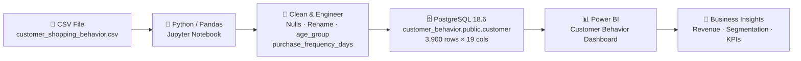

# Customer Shopping Behavior — Project Documentation

> [!NOTE]
> **Project Type:** Data Analytics Portfolio  
> **Tools Used:** Python (Pandas), PostgreSQL, Power BI  
> **Dataset:** `customer_shopping_behavior.csv` — 3,900 records × 18 columns

---

## Table of Contents

1. [Project Overview](#1-project-overview)
2. [Dataset Description](#2-dataset-description)
3. [Analysis Design](#3-analysis-design)
4. [Code & Outputs](#4-code--outputs)
   - [4.1 Data Loading](#41-data-loading)
   - [4.2 Data Preview — `df.head()`](#42-data-preview--dfhead)
   - [4.3 Dataset Info — `df.info()`](#43-dataset-info--dfinfo)
   - [4.4 Summary Statistics — `df.describe()`](#44-summary-statistics--dfdescribe)
   - [4.5 Missing Values Check](#45-missing-values-check)
   - [4.6 Handling Missing Values](#46-handling-missing-values)
   - [4.7 Column Cleaning](#47-column-cleaning)
   - [4.8 Feature Engineering — Age Group](#48-feature-engineering--age-group)
   - [4.9 Feature Engineering — Purchase Frequency Days](#49-feature-engineering--purchase-frequency-days)
   - [4.10 Duplicate Column Detection & Drop](#410-duplicate-column-detection--drop)
   - [4.11 Final Column List](#411-final-column-list)
   - [4.12 Database Export — PostgreSQL](#412-database-export--postgresql)
5. [Dashboard — Customer Behavior Dashboard](#5-dashboard--customer-behavior-dashboard)
6. [Key Insights](#6-key-insights)
7. [Pipeline Architecture](#7-pipeline-architecture)

---

## 1. Project Overview

This project analyzes customer shopping behavior using a structured end-to-end data analytics pipeline. The goal is to understand purchasing patterns across demographics, product categories, and shopping frequencies to derive actionable business insights.

**Objectives:**
- Profile customer demographics (age, gender, location)
- Analyze revenue and sales distribution by product category
- Understand the effect of discounts, promo codes, and subscriptions
- Segment customers by age group for targeted insights
- Export clean data to PostgreSQL for scalable querying
- Visualize KPIs through an interactive Power BI dashboard

---

## 2. Dataset Description

**File:** [`customer_shopping_behavior.csv`](file:///c:/Users/USER/Downloads/Data%20Analytics%20Portfolio/customer_shopping_behavior.csv)  
**Rows:** 3,900 | **Columns:** 18 (original) → 19 (after feature engineering)

| # | Column | Type | Description |
|---|--------|------|-------------|
| 0 | `Customer ID` | int64 | Unique customer identifier |
| 1 | `Age` | int64 | Customer age (18–70) |
| 2 | `Gender` | str | Male / Female |
| 3 | `Item Purchased` | str | Name of purchased item (25 unique) |
| 4 | `Category` | str | Product category: Clothing, Accessories, Footwear, Outerwear |
| 5 | `Purchase Amount (USD)` | int64 | Transaction value in USD (20–100) |
| 6 | `Location` | str | US state of purchase (50 unique) |
| 7 | `Size` | str | Item size: S, M, L, XL |
| 8 | `Color` | str | Item color (25 unique) |
| 9 | `Season` | str | Season of purchase: Spring, Summer, Fall, Winter |
| 10 | `Review Rating` | float64 | Customer rating 2.5–5.0 (37 nulls) |
| 11 | `Subscription Status` | str | Yes / No |
| 12 | `Shipping Type` | str | 6 types (Free Shipping, Express, etc.) |
| 13 | `Discount Applied` | str | Yes / No |
| 14 | `Promo Code Used` | str | Yes / No *(identical to Discount Applied — dropped)* |
| 15 | `Previous Purchases` | int64 | Count of past purchases (1–50) |
| 16 | `Payment Method` | str | PayPal, Credit Card, Cash, Venmo, etc. |
| 17 | `Frequency of Purchases` | str | Weekly, Monthly, Quarterly, etc. |

---

## 3. Analysis Design

```mermaid
flowchart TD
    A["📥 Raw CSV\n3,900 rows × 18 cols"] --> B["🔍 Exploratory Data Analysis\ndf.head / df.info / df.describe"]
    B --> C["🧹 Data Cleaning\nHandle nulls · Rename columns · Drop duplicates"]
    C --> D["⚙️ Feature Engineering\nage_group · purchase_frequency_days"]
    D --> E["🗄️ PostgreSQL Export\nSQLAlchemy · psycopg2"]
    E --> F["📊 Power BI Dashboard\nKPIs · Charts · Slicers"]
    F --> G["💡 Insights & Decisions"]
```



**Pipeline Stages:**

| Stage | Actions |
|-------|---------|
| **EDA** | `df.head()`, `df.info()`, `df.describe(include='all')`, null check |
| **Cleaning** | Impute `Review Rating` nulls with category median; lowercase & snake_case column names |
| **Feature Eng.** | `age_group` via `pd.qcut()` (4 quartile bins); `purchase_frequency_days` via frequency mapping |
| **Deduplication** | Confirmed `discount_applied == promo_code_used` (100%); dropped `promo_code_used` |
| **DB Export** | Connected to local PostgreSQL 18.6; uploaded to `customer_behavior.public.customer` |
| **Visualization** | Power BI with slicers, KPI cards, bar charts, donut chart |

---

## 4. Code & Outputs

### 4.1 Data Loading

```python
import pandas as pd
df = pd.read_csv('customer_shopping_behavior.csv')
```

---

### 4.2 Data Preview — `df.head()`

```python
df.head()
```

**Output:**

| | Customer ID | Age | Gender | Item Purchased | Category | Purchase Amount (USD) | Location | Size | Color | Season | Review Rating | Subscription Status | Shipping Type | Discount Applied | Promo Code Used | Previous Purchases | Payment Method | Frequency of Purchases |
|---|---|---|---|---|---|---|---|---|---|---|---|---|---|---|---|---|---|---|
| 0 | 1 | 55 | Male | Blouse | Clothing | 53 | Kentucky | L | Gray | Winter | 3.1 | Yes | Express | Yes | Yes | 14 | Venmo | Fortnightly |
| 1 | 2 | 19 | Male | Sweater | Clothing | 64 | Maine | L | Maroon | Winter | 3.1 | Yes | Express | Yes | Yes | 2 | Cash | Fortnightly |
| 2 | 3 | 50 | Male | Jeans | Clothing | 73 | Massachusetts | S | Maroon | Spring | 3.1 | Yes | Free Shipping | Yes | Yes | 23 | Credit Card | Weekly |
| 3 | 4 | 21 | Male | Sandals | Footwear | 90 | Rhode Island | M | Maroon | Spring | 3.5 | Yes | Next Day Air | Yes | Yes | 49 | PayPal | Weekly |
| 4 | 5 | 45 | Male | Blouse | Clothing | 49 | Oregon | M | Turquoise | Spring | 2.7 | Yes | Free Shipping | Yes | Yes | 31 | PayPal | Annually |

---

### 4.3 Dataset Info — `df.info()`

```python
df.info()
```

**Output:**

```
<class 'pandas.DataFrame'>
RangeIndex: 3900 entries, 0 to 3899
Data columns (total 18 columns):
 #   Column                  Non-Null Count  Dtype
---  ------                  --------------  -----
 0   Customer ID             3900 non-null   int64
 1   Age                     3900 non-null   int64
 2   Gender                  3900 non-null   str
 3   Item Purchased          3900 non-null   str
 4   Category                3900 non-null   str
 5   Purchase Amount (USD)   3900 non-null   int64
 6   Location                3900 non-null   str
 7   Size                    3900 non-null   str
 8   Color                   3900 non-null   str
 9   Season                  3900 non-null   str
 10  Review Rating           3863 non-null   float64
 11  Subscription Status     3900 non-null   str
 12  Shipping Type           3900 non-null   str
 13  Discount Applied        3900 non-null   str
 14  Promo Code Used         3900 non-null   str
 15  Previous Purchases      3900 non-null   int64
 16  Payment Method          3900 non-null   str
 17  Frequency of Purchases  3900 non-null   str
dtypes: float64(1), int64(4), str(13)
memory usage: 548.6 KB
```

> [!NOTE]
> Only `Review Rating` has missing values — **37 nulls** out of 3,900 records (~0.9%).

---

### 4.4 Summary Statistics — `df.describe()`

```python
df.describe(include='all')
```

**Output — Numeric Columns:**

| Statistic | Customer ID | Age | Purchase Amount (USD) | Review Rating | Previous Purchases |
|---|---|---|---|---|---|
| count | 3,900 | 3,900 | 3,900 | 3,863 | 3,900 |
| mean | 1,950.50 | 44.07 | 59.76 | 3.75 | 25.35 |
| std | 1,125.98 | 15.21 | 23.69 | 0.72 | 14.45 |
| min | 1 | 18 | 20 | 2.50 | 1 |
| 25% | 975.75 | 31 | 39 | 3.10 | 13 |
| 50% | 1,950.50 | 44 | 60 | 3.80 | 25 |
| 75% | 2,925.25 | 57 | 81 | 4.40 | 38 |
| max | 3,900 | 70 | 100 | 5.00 | 50 |

**Output — Categorical Columns (selected):**

| Statistic | Gender | Item Purchased | Category | Location | Subscription Status | Shipping Type | Payment Method | Frequency of Purchases |
|---|---|---|---|---|---|---|---|---|
| count | 3,900 | 3,900 | 3,900 | 3,900 | 3,900 | 3,900 | 3,900 | 3,900 |
| unique | 2 | 25 | 4 | 50 | 2 | 6 | 6 | 7 |
| top | Male | Blouse | Clothing | Montana | No | Free Shipping | PayPal | Every 3 Months |
| freq | 2,652 | 171 | 1,737 | 96 | 2,847 | 675 | 677 | 584 |

---

### 4.5 Missing Values Check

```python
df.isnull().sum()
```

**Output:**

| Column | Null Count |
|--------|-----------|
| Customer ID | 0 |
| Age | 0 |
| Gender | 0 |
| Item Purchased | 0 |
| Category | 0 |
| Purchase Amount (USD) | 0 |
| Location | 0 |
| Size | 0 |
| Color | 0 |
| Season | 0 |
| **Review Rating** | **37** |
| Subscription Status | 0 |
| Shipping Type | 0 |
| Discount Applied | 0 |
| Promo Code Used | 0 |
| Previous Purchases | 0 |
| Payment Method | 0 |
| Frequency of Purchases | 0 |

---

### 4.6 Handling Missing Values

```python
df['Review Rating'] = df.groupby('Category')['Review Rating'].transform(
    lambda x: x.fillna(x.median())
)
```

> [!TIP]
> Missing ratings are imputed with the **category-level median** instead of the global median — this preserves category-specific rating distributions and avoids data bias.

**Verification after imputation:**

```python
df.isnull().sum()
# All columns → 0 nulls ✅
```

---

### 4.7 Column Cleaning

```python
df.columns = df.columns.str.lower()
df.columns = df.columns.str.replace(' ', '_')
df = df.rename(columns={'purchase_amount_(usd)': 'purchase_amount_usd'})
```

**Resulting column names:**

```
Index(['customer_id', 'age', 'gender', 'item_purchased', 'category',
       'purchase_amount_usd', 'location', 'size', 'color', 'season',
       'review_rating', 'subscription_status', 'shipping_type',
       'discount_applied', 'promo_code_used', 'previous_purchases',
       'payment_method', 'frequency_of_purchases'],
      dtype='str')
```

---

### 4.8 Feature Engineering — Age Group

```python
labels = ['Young Adult', 'Adult', 'Middle_Aged', 'Senior']
df['age_group'] = pd.qcut(df['age'], q=4, labels=labels)
```

> [!NOTE]
> `pd.qcut()` creates **equal-frequency bins** (quartile-based), so each group contains roughly 975 customers.

**Output — `df[['age','age_group']].head(10)`:**

| | age | age_group |
|---|---|---|
| 0 | 55 | Middle_Aged |
| 1 | 19 | Young Adult |
| 2 | 50 | Middle_Aged |
| 3 | 21 | Young Adult |
| 4 | 45 | Middle_Aged |
| 5 | 46 | Middle_Aged |
| 6 | 63 | Senior |
| 7 | 27 | Young Adult |
| 8 | 26 | Young Adult |
| 9 | 57 | Middle_Aged |

---

### 4.9 Feature Engineering — Purchase Frequency Days

```python
frequency_mapping = {
    'fortnightly':    14,
    'weekly':          7,
    'monthly':        30,
    'quarterly':      90,
    'bi-weekly':      14,
    'annually':      365,
    'every 3 months': 90
}

df['purchase_frequency_days'] = (
    df['frequency_of_purchases']
    .str.strip()
    .str.lower()
    .map(frequency_mapping)
)
```

**Output — `df[['frequency_of_purchases', 'purchase_frequency_days']].head(10)`:**

| | frequency_of_purchases | purchase_frequency_days |
|---|---|---|
| 0 | Fortnightly | 14 |
| 1 | Fortnightly | 14 |
| 2 | Weekly | 7 |
| 3 | Weekly | 7 |
| 4 | Annually | 365 |
| 5 | Weekly | 7 |
| 6 | Quarterly | 90 |
| 7 | Weekly | 7 |
| 8 | Annually | 365 |
| 9 | Quarterly | 90 |

---

### 4.10 Duplicate Column Detection & Drop

```python
df[['discount_applied', 'promo_code_used']].head(10)
```

**Output:**

| | discount_applied | promo_code_used |
|---|---|---|
| 0–9 | Yes | Yes |

```python
(df['discount_applied'] == df['promo_code_used']).all()
# → True ✅
```

> [!IMPORTANT]
> `discount_applied` and `promo_code_used` are **100% identical** across all 3,900 rows. The redundant column `promo_code_used` was dropped.

```python
df = df.drop('promo_code_used', axis=1)
```

---

### 4.11 Final Column List

```python
df.columns
```

**Output:**

```
Index(['customer_id', 'age', 'gender', 'item_purchased', 'category',
       'purchase_amount_usd', 'location', 'size', 'color', 'season',
       'review_rating', 'subscription_status', 'shipping_type',
       'discount_applied', 'previous_purchases', 'payment_method',
       'frequency_of_purchases', 'age_group', 'purchase_frequency_days'],
      dtype='str')
```

**Final shape:** `(3900, 19)` — 18 original columns −1 dropped +2 engineered = **19 columns**

---

### 4.12 Database Export — PostgreSQL

```python
# Install dependencies
%pip install psycopg2-binary sqlalchemy
# Successfully installed psycopg2-binary-2.9.13 sqlalchemy-2.1.4

from sqlalchemy import create_engine, text

engine = create_engine(
    "postgresql+psycopg2://postgres:<password>@localhost:5432/customer_behavior"
)

# Test connection
with engine.connect() as connection:
    result = connection.execute(text("SELECT version();"))
    print(result.fetchone()[0])
# → PostgreSQL 18.6 on x86_64-windows, compiled by msvc-19.44.35229, 64-bit
# → Connection successful!

# Upload to PostgreSQL
df.to_sql(
    name="customer",
    con=engine,
    schema="public",
    if_exists="replace",
    index=False
)
print("Customer data uploaded successfully!")
```

**Database Details:**

| Parameter | Value |
|-----------|-------|
| Host | localhost |
| Port | 5432 |
| Database | `customer_behavior` |
| Schema | `public` |
| Table | `customer` |
| PostgreSQL Version | 18.6 |
| Rows Loaded | 3,900 |

---

## 5. Dashboard — Customer Behavior Dashboard


**Tool:** Power BI  
**Theme:** Purple / Dark Violet

### KPI Cards

| Metric | Value |
|--------|-------|
| 📦 Number of Customers | **4K** (3,900) |
| 💰 Average Purchase Amount | **\$59.76** |
| ⭐ Average Review Rating | **3.75** |

### Visuals

| Chart | Type | Insight |
|-------|------|---------|
| % of Customers by Subscription Status | Donut | 73% No subscription · 27% Yes (3.9K shown) |
| Revenue by Category | Bar Chart | Clothing leads (\~100K), then Accessories (\~70K), Footwear, Outerwear |
| Sales by Category | Bar Chart | Clothing: ~1,700 orders, Accessories: ~1,300, Footwear: ~500, Outerwear: ~200 |
| Revenue by Age Group | Horizontal Bar | Young Adult leads, followed by Middle Aged, Adult, Senior |
| Sales by Age Group | Horizontal Bar | Young Adult: ~950, Middle Aged: ~900, Senior: ~700, Adult: ~650 |

### Slicers / Filters

| Filter | Options |
|--------|---------|
| Subscription Status | No / Yes |
| Gender | Female / Male |
| Category | Accessories · Clothing · Footwear · Outerwear |
| Shipping Type | 2-Day Shipping · Express · Free Shipping · Next Day Air · Standard · Store Pickup |

---

## 6. Key Insights

| # | Insight | Business Implication |
|---|---------|---------------------|
| 1 | **73% of customers are non-subscribers** | Significant subscription growth opportunity |
| 2 | **Clothing dominates both revenue and volume** | Prioritize inventory & promotions in Clothing |
| 3 | **Young Adults & Middle-Aged are top spenders** | Target marketing campaigns to 18–57 age range |
| 4 | **Average purchase: \$59.76** | Mid-range pricing is the sweet spot |
| 5 | **Average rating: 3.75 / 5** | Room to improve customer satisfaction programs |
| 6 | **Free Shipping is the most common shipping type** (675 orders) | Free shipping drives purchase decisions |
| 7 | **PayPal is the top payment method** (677 users) | Optimize PayPal checkout experience |
| 8 | **Discount Applied = Promo Code Used (100%)** | These are the same lever — one metric suffices |
| 9 | **Blouse is the most purchased item** (171 orders) | High-demand SKU for inventory planning |
| 10 | **Montana is the top state by order volume** | Geographic concentration for logistics optimization |

---

## 7. Pipeline Architecture



---

*Documentation generated: October 30, 2026*  
*Notebook:* [`customer_shopping_behaviour_analysis.ipynb`](file:///c:/Users/USER/Downloads/Data%20Analytics%20Portfolio/customer_shopping_behaviour_analysis.ipynb)
# CustomerPulse-Analytics

